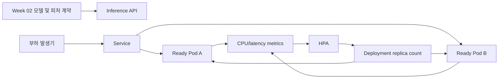
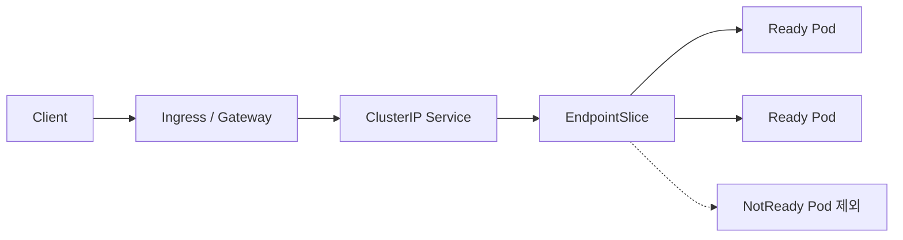

# Week 03 · AI 추론 서비스는 언제, 어디서 확장해야 할까?

**학습 범위:** CH6 · Scaling Up / CH7 · Internal Services and Load Balancing  
**확장 관점:** CPU 기반 HPA의 한계, 콜드 스타트, EndpointSlice, AI 서빙의 병목 분류  
**검증 상태:** 실험 설계와 코드 작성 완료. 실제 Kubernetes 수치 측정은 아직 수행하지 않았다.

2주차에는 MLflow로 고정된 모델을 선택하고 Feast·KFP로 입력 피처와 배치 추론의 재현성을 확인했다. 그러나 **동일한 모델을 불러올 수 있는 것과 동시에 많은 추론 요청을 안정적으로 처리하는 것은 다른 문제**다. 이번 주에는 한 가지 질문을 끝까지 추적한다. **응답이 느려지면 Pod부터 늘려야 할까?**

## 1. 추론 서비스 운영 시나리오



실습에서는 모델 정확도와 플랫폼 병목을 혼동하지 않도록 **학습 모델 대신 합성 CPU 연산과 대기 응답**을 이용한다. 추후 고정 MLflow 모델을 로딩할 때에도 측정 환경과 모델 버전을 별도로 기록한다.

| 계층 | 책임 | 책임이 아닌 것 |
|---|---|---|
| Deployment | 이미지, 복제본, 준비 상태 | 최종 사용자 p95 |
| HPA | 주어진 메트릭 기준 replica 목표 | 노드 증설, 즉각적인 준비 완료 |
| Node Autoscaler | 스케줄할 컴퓨팅 용량 | 모델 로딩·앱 초기화 |
| Service·EndpointSlice | 내부 주소와 백엔드 엔드포인트 | 앱 내부 연산 성능 |
| Ingress·Gateway | 외부 HTTP 라우팅과 TLS 구성 | 학습·추론 로직 |
| Prometheus·Grafana | 시간에 따른 상태 관측 | 병목 자동 해결 |

## 2. CH6 · 세 가지 확장을 구별하기

- **Horizontal:** 복제본 수 증가. 독립된 요청이 병렬로 들어올 때 유리하지만, 각 Pod의 모델 메모리 사용이 중복될 수 있다.
- **Vertical:** Pod의 CPU·메모리 requests/limits 조정. 큰 요청에는 도움이 될 수 있으나 애플리케이션 병목이 사라지는 것은 아니다.
- **Node scaling:** Pod가 스케줄될 실제 노드 용량 확보. kind의 수동 노드 관리와 클라우드 Cluster Autoscaler/Karpenter는 별도 방식이다.

HPA의 기본적인 계산식은 다음과 같다.

```text
desiredReplicas ≈ ceil(currentReplicas × currentMetric / desiredMetric)
```

현재 2개, 평균 CPU utilization 80%, 목표 50%라고 가정하면 **계산상 목표는 4개**다. 이 수치는 *설명용*이며 실제 HPA에는 tolerance, 초기화 시간, 누락 메트릭, 안정화 구간과 min/max 제약이 적용된다. 특히 CPU utilization의 분모는 **CPU limit이 아니라 CPU request**다.

### CPU가 낮은데 지연이 높다면?

| 가설 | 트래픽 유형 | 관측 지표 | 판단 |
|---|---|---|---|
| A | CPU 계산 부하 | utilization, HPA desired/current, p95 | CPU 압박이 replica 증설로 완화되는지 |
| B | 외부 대기·I/O 유사 부하 | 낮은 CPU, 높은 p95, 실패율 | CPU만 보는 HPA의 사각지대 확인 |
| C | 느린 서버 준비 | Pod 생성 시각, Ready 시각, 첫 성공 응답 | replica 증가와 사용 가능한 용량 증가의 시간차 |

**주의:** 이 가설은 결과가 아니다. 결과 수치와 그래프는 고정된 환경에서 재현한 뒤 넣는다. 실행되지 않은 실험을 성공으로 표현하지 않는다.

## 3. CH7 · 네트워크 경로는 별도로 추적해야 한다



Service의 ClusterIP가 존재해도 모든 Pod가 요청을 받을 수 있는 것은 아니다. EndpointSlice의 ready 상태가 변하고, 새 연결이 어디로 전달되는지 확인해야 한다. **프로브 실패·Service 선택자 오류·CoreDNS 문제·Ingress 구성 오류**를 추론 지연과 한 원인으로 뭉뚱그리지 않는다.

| 증상 | 가장 먼저 확인할 것 |
|---|---|
| Service 주소는 있지만 요청 실패 | selector, EndpointSlice, Pod Ready |
| 서비스 이름으로 연결 안 됨 | namespace, DNS 이름, CoreDNS |
| 외부 요청만 실패 | Ingress Controller, host/path, TLS |
| CPU 낮고 p95 높음 | 대기열, 외부 호출, 스레드/worker, 연결 풀 |
| Pod Pending | describe Pod의 FailedScheduling 이벤트 |

## 4. 이론과 실습을 연결하는 방식

| 학습 순서 | 상세 글 | 실행 증거 |
|---|---|---|
| 09 · HPA와 합성 추론 부하 | [추론이 느려질 때 Pod부터 늘려야 할까?](/ml-platform/week03-autoscaling) | metrics-server, HPA, RPS, p95 |
| 10 · 요청 경로 진단 | [요청은 어느 Pod까지 도달하는가?](/ml-platform/week03-traffic) | Service, EndpointSlice, readiness |
| 심화 · LLM/RAG 확장 | [KServe·vLLM](/ml-platform/week-06) | CPU 외 queue depth·TTFT·토큰 처리량 개념 |

이번 구성의 목표는 명령어 실행 자체가 아니다. **증상 → 가설 → 측정 → 반증 가능성 → 개선 기준**을 하나의 운영 기록으로 남기는 것이다.

## 5. AI 플랫폼 엔지니어의 설계 메모

CPU 기반 HPA는 시작점으로 적절하지만 GPU 모델 서빙에서는 GPU 메모리, 배치 스케줄러, 토큰 처리량, 대기열 길이, TTFT·ITL 등이 더 직접적인 병목 신호일 수 있다. 이 값들은 metrics adapter 또는 별도 autoscaler와 연동해야 하며, HPA가 기본적으로 모두 수집하는 것은 아니다.

또한 여러 Pod의 평균 사용률은 **일부 과열된 Pod**를 가릴 수 있다. Readiness와 부하 분배, graceful shutdown, 모델 예열을 함께 설계해야 한다. Pod가 Ready가 되는 시간과 사용자가 정상 응답을 받는 시간도 구별한다.

## 6. 실습을 완료했다고 판단할 기준

1. 사용한 클러스터/이미지/부하 발생 조건을 고정한다.
2. Baseline, CPU 부하, Wait 부하에서 같은 기간 RPS·p50·p95·실패율을 기록한다.
3. HPA desired/current와 실제 Ready Pod 수를 시간 축으로 함께 기록한다.
4. Readiness 변화 전후 EndpointSlice의 ready 상태를 저장한다.
5. 추정과 관측을 구분하고 가설에 불리한 결과도 그대로 남긴다.

**현재 상태:** 코드 및 검증 계획을 작성했지만 클러스터 실행 기록은 없다. 아래의 상세 페이지는 재현을 위한 명령과 결과 기록 양식을 제공한다.

참고: [Kubernetes HPA](https://kubernetes.io/docs/tasks/run-application/horizontal-pod-autoscale/), [Kubernetes Service](https://kubernetes.io/docs/concepts/services-networking/service/), [Gateway API](https://gateway-api.sigs.k8s.io/)
