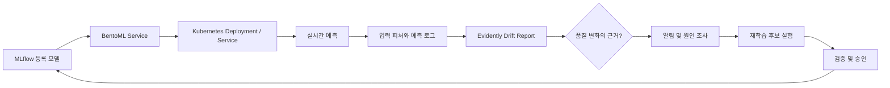
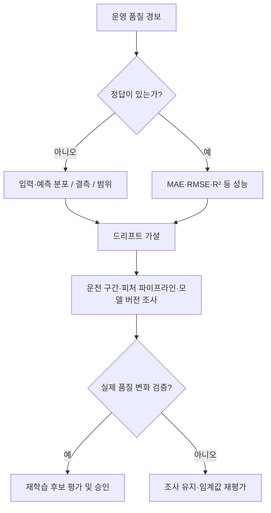

# 11 · 정상 응답하는 모델이 잘못된 예측을 한다면?

**3주차 확장 주제 · BentoML 모델 서빙 × Data Drift × Evidently × 배포 승인 기준**

이번 글은 교재 CH6·7을 대체하는 본문이 아니라 **우리만의 확장 학습**이다. CH6·7의 인프라 확장·트래픽 처리에서 한 단계 더 나아가, 모델이 빠르고 정상적으로 응답하는데도 예측 신뢰도가 떨어지는 상황을 다룬다.

## 1. 가용성과 예측 품질은 서로 다른 축이다



| 측정 | 질문 | 대표 지표 | 도구 |
|---|---|---|---|
| 서비스 신뢰성 | 응답이 정상 도착했나? | RPS, p95, 5xx | Prometheus, Grafana |
| 인프라 용량 | 부하를 감당하나? | CPU, memory, HPA replicas | Kubernetes |
| 데이터 건강성 | 입력 조건이 바뀌었나? | 결측률, 범위 위반, 분포 차이 | Evidently |
| 모델 품질 | 예측이 실제 정답과 일치하나? | RMSE, MAE, MAPE, R² | MLflow, 정답 지연 수집 |

HTTP 200과 모델 성능 유지 사이에는 직접적인 보증 관계가 없다. **드리프트 탐지 결과만으로 모델 성능 저하가 확정되는 것도 아니다.**

## 2. BentoML: 모델 코드에서 재현 가능한 API로

BentoML은 `@bentoml.service`와 `@bentoml.api`로 모델 추론 인터페이스를 정의하고, 서빙 환경을 패키징하여 실행하는 프레임워크다. Kubernetes의 Service·HPA 자체를 대체하는 도구는 아니다. **BentoML은 애플리케이션 서빙 계층, Kubernetes는 배치·네트워킹·스케일링 계층**이라는 책임 분리가 중요하다.

```python
# 개념 예제: 실제 제조 모델이 아닌 합성 점수 서비스
import bentoml

@bentoml.service(resources={"cpu": "1"}, traffic={"timeout": 10})
class QualityScore:
    @bentoml.api
    def predict(self, temperature: float, pressure: float, speed: float) -> float:
        return float(0.2 * temperature + 0.3 * pressure + 0.5 * speed)
```

```bash
# 독립 가상환경에서 공식 문서 버전에 맞춰 설치
python3 -m venv .venv
source .venv/bin/activate
pip install bentoml
bentoml serve service:QualityScore
```

위 식은 서빙 구조 설명을 위한 예제이며 학습 모델도 실측 결과도 아니다. 실제 2주차 RandomForest를 연결한다면 모델 버전 URI, 입력 피처 순서, 자료형, 예측 로그의 모델 ID를 고정해야 한다. `bentoml build`·`containerize`는 사용하는 BentoML 버전의 권장 패키징 방식을 먼저 확인한다.

### FastAPI / BentoML / KServe / vLLM의 책임

| 도구 | 핵심 책임 | 채택 기준 |
|---|---|---|
| FastAPI | 범용 Python API | 자유로운 API 구현·기존 웹 서비스 통합 |
| BentoML | ML 서빙 API와 패키징 | 모델 중심 서비스 관리·배포 구조 |
| KServe | Kubernetes 모델 서빙 추상화 | 여러 모델·팀의 서빙 운영 표준화 |
| vLLM | LLM 토큰 생성 엔진 | GPU 추론·배칭·KV 캐시 효율 최적화 |

한 시스템에서 여러 도구를 조합할 수 있지만, 기능 중복·운영 복잡도·실제 성능을 측정하고 선택해야 한다.

## 3. Data Drift와 Concept Drift를 구분한다

- **Data drift / covariate shift:** 입력 분포 `P(X)`가 바뀐다. 예를 들어 제조 설비 온도·압력의 운전 구간이 학습 시점과 달라진다.
- **Concept drift:** 입력과 정답의 관계 `P(Y|X)`가 바뀐다. 같은 온도·압력에서도 설비 마모나 공정 변경으로 실제 품질이 달라지는 경우가 예다.
- **Prediction drift:** 모델 출력값 분포가 바뀐다. 입력 변화와 연계될 수 있지만 이것만으로 원인을 특정하지 못한다.
- **Training-serving skew:** 학습과 실시간 추론의 피처 변환이나 버전이 불일치한다. 시간적 변화가 없어도 발생할 수 있다.



핵심은 **정답 없는 드리프트 탐지와 정답 기반 성능 검증을 구별**하는 것이다.

## 4. Evidently로 Reference와 Current 비교

Evidently는 reference dataset과 current dataset을 비교해 입력·출력 분포의 변화를 분석하고 리포트로 출력한다. 도구 버전에 따라 API가 달라지므로 이전 `DataDriftPreset` 문법을 무조건 최신 버전으로 가정하지 않는다.

```python
# Evidently 최신 API 계열의 개념 예시. 설치 버전과 import 경로 확인 필요.
from evidently import Report, Dataset
from evidently.presets import DataDriftPreset
import pandas as pd

reference_df = pd.read_csv("reference.csv")
current_df = pd.read_csv("current.csv")
report = Report([DataDriftPreset()])
result = report.run(
    current_data=Dataset.from_pandas(current_df),
    reference_data=Dataset.from_pandas(reference_df),
)
result.save_html("drift-report.html")
```

학습용 CSV는 2주차 합성 제조 데이터 계약과 동일한 피처명 `temperature`, `pressure`, `speed`를 사용하도록 맞춘다. 실제 비교 전에는 reference의 선택 시점과 현행 데이터의 기간·표본 수·결측·시즌성을 기록한다.

### 드리프트 탐지 설계

| 실험 | 변화시킬 조건 | 기대하는 확인 사항 |
|---|---|---|
| 기준선 | 동일 생성 규칙, 다른 표본 | 정상 데이터에서도 검정 오탐 가능성 |
| 운전 구간 이동 | temperature 평균 이동 | 분포 차이 감지 |
| 분산 증가 | pressure 변동 폭 확대 | 평균만 보면 놓치는 변화 |
| 범위 외 입력 | speed가 계약 상한 초과 | 통계 검정 전에 데이터 계약 위반 |
| Concept 변화 | 동일 X, 다른 Y 생성식 | X 드리프트만으로는 미탐 가능 |

데이터 드리프트의 검정 임계값과 표본 크기는 탐지 민감도에 영향을 준다. 여러 피처를 동시에 검사할 때 다중 비교와 계절성도 검토한다. 실제 품질 이슈의 크기와 통계적 유의성을 구분해야 한다.

## 5. 경보는 재학습 명령이 아니다

단일 drift flag로 재학습을 바로 실행하면 불필요한 배포·학습 비용이나 잘못된 모델 교체로 이어질 수 있다. 운영 정책은 **관찰 → 검증 → 후보 모델 생성 → 오프라인 비교 → 배포 승인 → 카나리 검증** 순서로 설계한다.

| 조건 | 권장 조치 |
|---|---|
| Drift 감지, 성능 정답 없음 | 로그·표본 확인, 드리프트 원인 조사 |
| Drift 감지 + 성능 악화 | 피처·라벨 지연·세그먼트 분석 후 재학습 후보 |
| Drift 미감지 + 성능 악화 | concept drift, skew, 버그 점검 |
| Drift 감지 + 성능 정상 | 모니터링 강화, 즉각 배포 보류 가능 |
| 서비스 오류율 증가 + Drift 없음 | 서빙·네트워크·자원 문제 우선 |

## 6. 2주차 산출물과 연결할 때 유지할 계약

- **MLflow:** 학습 run, 모델 버전, 선정 이유, 원본 해시
- **Feast:** entity, event_timestamp, feature names, online/offline 기준
- **KFP:** 검증 단계, 예측 파일, drift report artifact의 입출력 계약
- **BentoML:** 추론 API 스키마와 고정 모델 아티팩트 로딩
- **Evidently:** reference/current 메타데이터, 피처 별 결과, 리포트 생성 시점
- **Kubernetes:** 이미지 다이제스트, Service 경로, replica/Ready 및 운영 지표

모델 품질 이력을 확인하려면 각 예측에 모델 버전·데이터 시각·요청 추적 ID를 연결해야 한다. 다만 개인정보나 민감한 원문 데이터를 모니터링 로그에 그대로 남기는 설계는 피한다.

## 7. 검증 범위와 후속 실습

이 글은 설계·코드 초안이다. **BentoML 실제 서비스 실행, Evidently drift HTML 생성, Kubernetes 배포, 성능 측정은 아직 수행하지 않았다.** 실행 성공을 주장하려면 CLI 버전, 데이터 생성 스크립트, 실제 보고서, 결과 수치와 GitHub Actions/클러스터 로그를 추가해야 한다.

[3주차 학습 정리로 돌아가기](/ml-platform/study-week-03)

공식 참고: [BentoML Service](https://docs.bentoml.com/en/latest/build-with-bentoml/services.html), [Bento Packaging](https://docs.bentoml.com/en/latest/get-started/packaging-for-deployment.html), [Evidently Docs](https://docs.evidentlyai.com/), [Evidently API](https://evidentlyai.github.io/evidently/api-reference/main/evidently/core/report.html)
